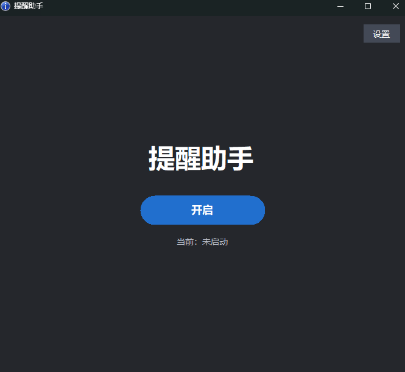
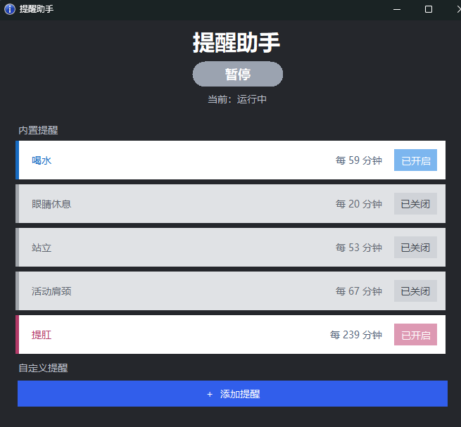

# 提醒助手

轻量 Windows 托盘应用。首次打开时总开关关闭。点击「开启」后可使用五项内置提醒，并按需添加自定义提醒。

| 内置提醒 | 默认间隔 |
| --- | ---: |
| 喝水 | 59 分钟 |
| 眼睛休息 | 20 分钟 |
| 站立 | 53 分钟 |
| 活动肩颈 | 67 分钟 |
| 提肛 | 239 分钟 |

点击提醒名称可以调整间隔。新建自定义提醒默认关闭。多个提醒同时到点时合并显示，弹窗提供「稍后 5 分钟」。关闭主窗口会收起到托盘，从托盘菜单可完全退出。

## 界面预览

### 未启动



### 运行中



## 下载和安装

[下载 Windows 安装包](downloads/TixingSetup.exe?raw=true)

## 从源码构建

在 Windows 上打开 PowerShell，在仓库目录运行以下命令。构建使用 Windows 的 .NET Framework 4.x C# 编译器。

```powershell
powershell -NoProfile -ExecutionPolicy Bypass -File .\build.ps1
```

构建后运行 `dist\TixingSetup.exe`。安装向导允许选择目标磁盘和文件夹，也可以勾选登录 Windows 时自动启动。应用内的「设置」可以随时修改自动启动选项。通过登录自启时，提醒助手会在托盘运行并开启总开关。

设置保存在当前用户的 `%LOCALAPPDATA%\Tixing\settings.xml`。卸载时，从托盘退出助手，再双击安装目录中的「卸载提醒助手.exe」。确认后会删除提醒设置、快捷方式和自启项。

## 源代码

- `Reminder.cs` 包含主界面、提醒调度、通知弹窗和托盘功能。
- `Setup.cs` 包含安装向导和卸载入口。
- `build.ps1` 构建桌面程序和安装包。